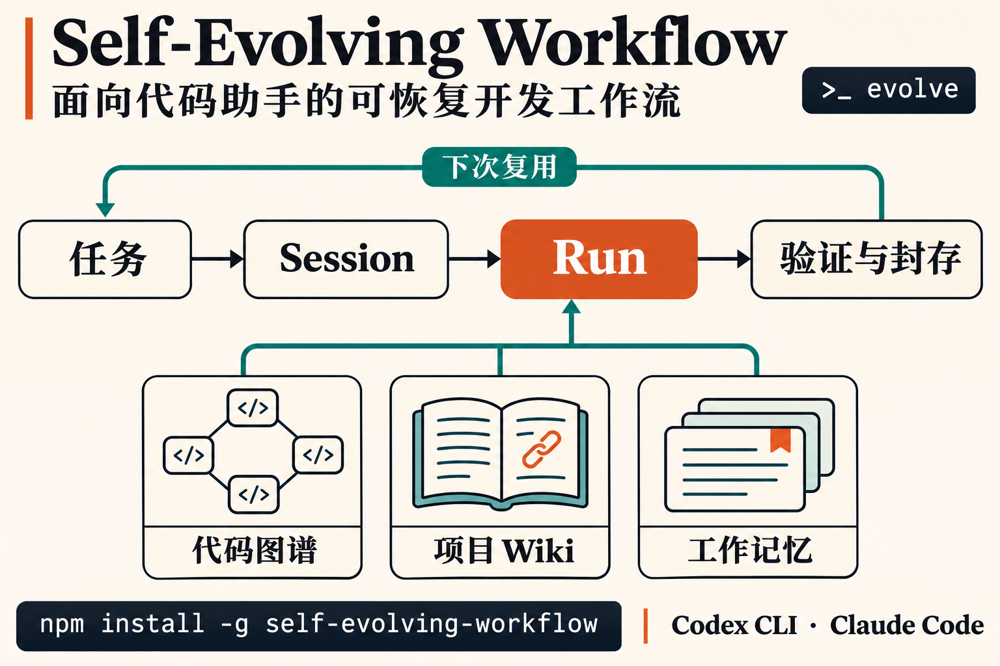
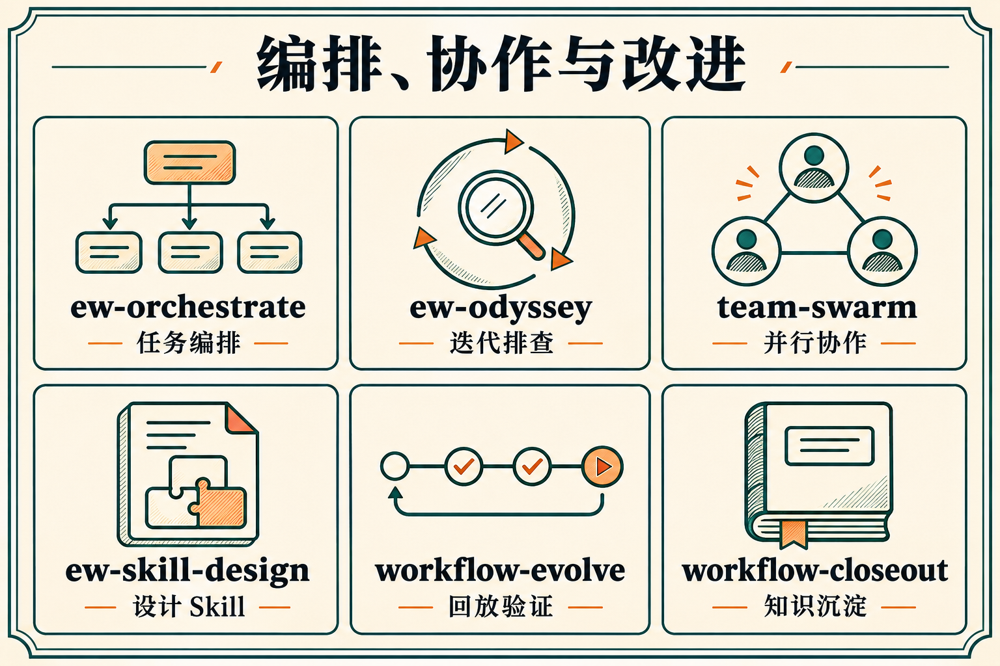
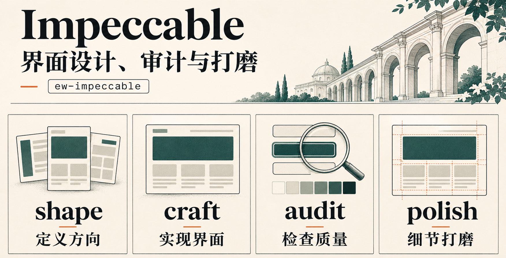

# Self-Evolving Workflow

面向代码助手的可恢复开发工作流。用 `evolve` 编排任务、记录验证证据，并从代码图谱、项目 Wiki 和工作记忆中检索上下文。每个 Run 可以绑定 Git 中的 Skill 版本，让后续执行可以恢复和复查。

[npm 安装包](https://www.npmjs.com/package/self-evolving-workflow) · [Session 与 Run 指南](skills/ew-orchestrate/references/orchestrator-run-loop.md) · [MIT 许可证](LICENSE)



## 快速开始

需要 Node.js `22.16.0` 或更新版本。项目工作流还需要 Git，用来固定 Run 所使用的 Skill 版本。

```sh
npm install -g self-evolving-workflow
evolve --help
```

从旧包名迁移时，先运行 `npm uninstall -g evolve-agent-memory`，再安装 `self-evolving-workflow`。现有脚本可以继续使用 `agent-memory`。两个入口共用项目 Wiki、记忆数据库和代码图谱索引。

### 安装工作流 Skill

按项目安装时，在 Git 根目录运行命令并提交生成的 `skills/` 和 `AGENTS.md`。用户级安装适用于同一台机器上的多个项目。

| 范围 | 命令 | 位置 |
| --- | --- | --- |
| 当前项目 | `evolve install --scope project --yes` | `skills/`、`AGENTS.md` |
| Codex CLI | `evolve install --scope user --host codex --yes` | `~/.codex/skills/`、`~/.codex/AGENTS.md` |
| Claude Code | `evolve install --scope user --host claude --yes` | `~/.claude/skills/`、`~/.claude/CLAUDE.md` |

直接运行 `evolve install` 可以交互选择安装范围和 Skill。自动化安装时可用 `--skill <名称>` 指定单个包。

### 验证项目知识检索

```sh
evolve memory put "发布前运行回归测试。" --id quickstart-regression --type work_method --session quickstart
evolve context "回归测试" --session quickstart --include-memory
```

在查询结果的 `working_memories` 中可以找到 `quickstart-regression`。本地记忆和 Wiki 检索可直接使用。通过模型抽取记忆或导入文本时，可配置 OpenAI 兼容的模型接口。

接下来可以在代码助手中运行一次轻量任务。

> 读取项目的 `AGENTS.md` 和 `skills/ew-orchestrate/SKILL.md`，使用 `ew-companion` 开一轮 Evolve Run，验证刚写入的回归测试记忆能被检索，并完成 Session。

用 `evolve session list` 查看 Session，用 `evolve workflows show session-run` 查看命令行的分派、封存和恢复步骤。

## 随包提供的 Skills



| Skill | 适用任务 |
| --- | --- |
| [ew-orchestrate](skills/ew-orchestrate/SKILL.md) | 编排分析、计划、执行和评审。单个可验证任务走内置的 `ew-companion` 步骤。 |
| [ew-odyssey](skills/ew-odyssey/SKILL.md) | 迭代排查、多维评审、安全审计和 UI 改进。 |
| [team-swarm](skills/team-swarm/SKILL.md) | 对候选方案并行探索、评分和复核。 |
| [ew-skill-design](skills/ew-skill-design/SKILL.md) | 设计或移植 Skill，定义输入、交付物和验证方式。 |
| [workflow-evolve](skills/workflow-evolve/SKILL.md) | 根据执行记录提出改进，用回放比较基线与候选版本。 |
| [workflow-closeout](skills/workflow-closeout/SKILL.md) | 将 Session 收尾、知识候选和 Wiki 审查交给统一的知识流程。 |
| [ew-impeccable](skills/ew-impeccable/SKILL.md) | 为 Web 和原生移动界面制定方向、实现设计、审计和打磨。 |

### Impeccable 界面设计



从 Maestro Flow 移植的 Impeccable 4.1.3 随包提供设计手册、界面检测器和 Live 辅助脚本。用 `shape` 明确需求和设计方向，用 `craft` 进入界面实现，用 `audit` 检查可访问性、响应式和性能，用 `polish` 完成发布前的细节检查。

```sh
evolve install --scope project --skill ew-impeccable --yes
evolve workflows show ew-impeccable
```

项目安装后，可以请代码助手读取 `skills/ew-impeccable/SKILL.md` 并对指定页面执行 `audit`。用户级安装可在 Codex CLI 调用 `$ew-impeccable`，或在 Claude Code 调用 `/ew-impeccable`。需要把执行证据纳入 Session 时，提交项目 Skill 后使用 `ew-impeccable` 作为 Run 步骤。

## 项目知识与代码图谱

Run 通过 MCP 读取项目知识时，回执会记录搜索范围、条目 ID 和正文校验值。Session 可以把已读取的知识固定为后续步骤的输入。Skill 改进以提案形式进入评审和回放，通过验证后再应用。运行状态和工作记忆保存在项目的 `.agent-memory/`，正式 Wiki 条目位于 `wiki/entries/`。 [知识使用与沉淀](skills/ew-orchestrate/references/knowledge-route.md)

在 Git 根目录打开 Session，或首次用 `evolve` 查询代码时，会自动在项目的 `.codegraph/` 中建立索引。之后打开 Session 或查询代码时，CLI 会先同步新增、修改和删除的文件。只查 Wiki 或记忆时无需建立代码图谱。

```sh
evolve code search "<symbol>"
evolve code callers "<symbol-id>" --depth 2
evolve code trace "<from-id>" "<to-id>"
evolve search "<query>" --scope code
```

可以用 `evolve code build` 手动全量索引，也可以用 `evolve code sync` 手动更新已有索引。使用兼容入口 `agent-memory` 的脚本仍可按原方式显式执行 `code build` 和 `code sync`。

## 从 Maestro Flow 迁移

在旧项目根目录预览迁移。`--knowhow-only` 只选择 `.workflow/knowhow/` 中的 Knowhow。确认预览后加上 `--apply`，将条目作为 Wiki `reference` 写入并建立索引。

```sh
evolve knowledge import --knowhow-only
evolve knowledge import --knowhow-only --apply
```

迁往另一个项目时，传入源项目路径，并用 `--root` 指定目标。要同时导入旧 Spec，使用 `evolve knowledge import` 预览。带仓库限制的条目可用 `evolve wiki references "关键词" --repository "<仓库 UUID>"` 检索。 [迁移与项目范围](skills/ew-orchestrate/references/knowledge-route.md)

## 源码开发

```sh
git clone https://github.com/catlog22/self-evolving-workflow.git
cd self-evolving-workflow
npm ci
npm test
```

`npm test` 会编译 TypeScript 并运行回归测试。源码检出可用 `node dist/workflow-cli.js --help` 和 `node dist/cli.js --help` 查看两个入口。

## 致谢

工作流延续了 Maestro Flow 的 Session、Run 和 Skill 生命周期设计。代码图谱的自动初始化和同步参考了 Maestro Flow 的启动及提交提示词钩子。记忆和 Wiki 实现复用了 TencentDB Agent Memory 的部分 MIT 代码。 [Maestro Flow](https://github.com/catlog22/maestro-flow) · [Maestro Flow 图谱初始化](https://github.com/catlog22/maestro-flow/blob/master/src/hooks/kg-auto-init.ts) · [Maestro Flow 图谱同步](https://github.com/catlog22/maestro-flow/blob/master/src/hooks/kg-sync-hook.ts) · [TencentDB Agent Memory](https://github.com/TencentCloud/TencentDB-Agent-Memory/tree/42d4cde50c5a83182fced8c584f9ddb32a620615)

Impeccable 由 Paul Bakaus 创建，经 Maestro Flow 适配，本项目保留其 Apache-2.0 许可证和第三方说明。 [来源与版本](skills/ew-impeccable/UPSTREAM.md) · [许可证](skills/ew-impeccable/LICENSE) · [第三方说明](skills/ew-impeccable/NOTICE.md)
